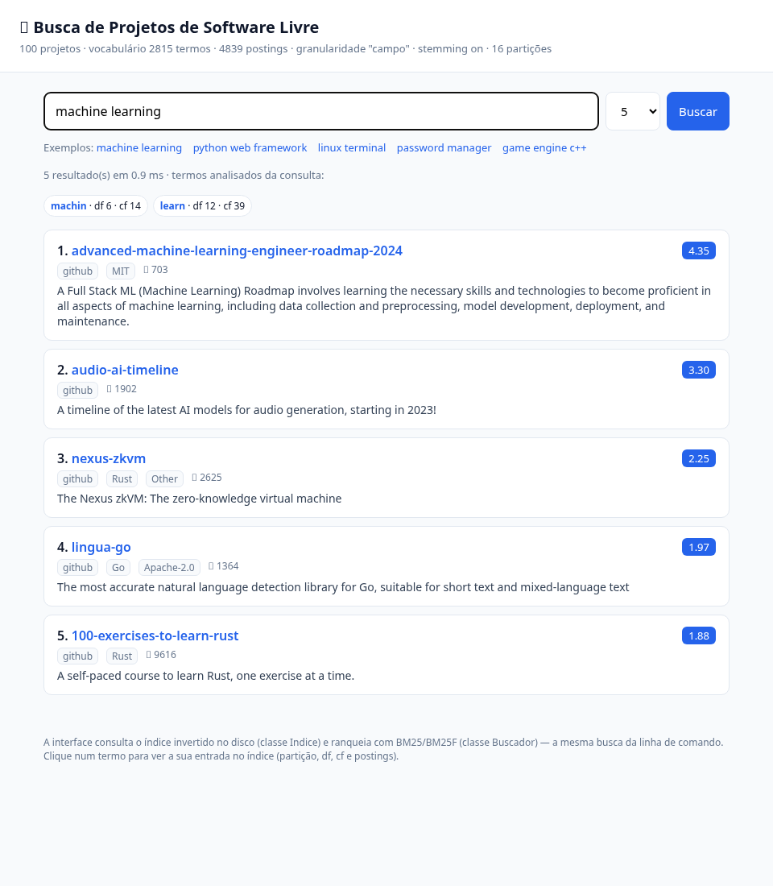

# 🗂️ Coletor de Projetos de Software Livre (GitHub e SourceForge)

## 🎯 Objetivo

Esta é a primeira etapa de um sistema de busca de projetos de software livre.
O coletor monta o acervo de documentos que será indexado na etapa seguinte.
Cada documento é a página de um projeto:

- um repositório do GitHub (`github.com/dono/repo`);
- um projeto do SourceForge (`sourceforge.net/projects/nome/`).

A meta é passar de 50 mil páginas de projeto, cerca de 25 mil de cada site.

O coletor é um coletor web clássico, igual ao modelo visto em aula: ele baixa o
HTML das páginas com GET, extrai os links e segue esses links. Não usa nenhuma
API e não precisa de token.

## ⚙️ Como funciona

1. Começa com as seeds na fila.
2. Pega uma URL da fila, confere o robots.txt e baixa o HTML com GET.
3. Salva o conteúdo: o HTML bruto compactado e, nas páginas de projeto, os
   campos extraídos.
4. Extrai os links da página.
5. Coloca na fila só os links novos (que não estão no conjunto de URLs
   conhecidas) e que passam no filtro de seleção.
6. Repete até atingir a meta de páginas de projeto ou a fila acabar.

Cada site tem a sua própria fila e a sua própria thread (uma versão simples da
Fila de Mercator). Os dois sites são coletados ao mesmo tempo, mas cada um
recebe no máximo um pedido por vez, com pelo menos 1 segundo entre pedidos.

**Seeds**

- GitHub: `github.com/topics` e as páginas de 30 tópicos populares (python,
  javascript, machine-learning, java, linux etc.), com a paginação `?page=1`
  até `?page=50`.
- SourceForge: `sourceforge.net/directory/` e 18 categorias do diretório, com
  a paginação `?page=1` até `?page=20`, mais os sitemaps listados no
  robots.txt do SourceForge.

**Links aceitos**

- GitHub: páginas de tópico (`/topics/nome`, com no máximo `?page=N`) e páginas
  raiz de repositório (`/dono/repo`, sem nada depois).
- SourceForge: raiz de projeto (`/projects/nome/`), páginas do diretório
  (`/directory/...`, com no máximo `?page=N`) e os sitemaps de projetos e do
  diretório.

Todo o resto (login, issues, pulls, commits, arquivos, downloads, reviews,
rss etc.) é descartado antes de entrar na fila.

## 📋 Requisitos

- Python 3.9 ou mais novo
- Bibliotecas: `requests`, `protego`, `beautifulsoup4` e `lxml`

## ▶️ Execução

Instale as dependências (de preferência num ambiente virtual):

    python -m venv .venv
    .venv\Scripts\activate            (Windows)
    source .venv/bin/activate         (Linux/Mac)
    pip install -r requirements.txt

Teste rápido (100 páginas de projeto por site):

    python run_coletor.py --target 100

Coleta completa (25 mil páginas de projeto por site):

    python run_coletor.py --target 25000

Se a coleta for interrompida (Ctrl+C, queda de energia, erro), basta rodar o
mesmo comando de novo. O estado fica salvo no SQLite e a coleta continua de
onde parou, sem baixar de novo o que já foi baixado.

Ao terminar, o coletor exporta `data/projetos.jsonl` e mostra as estatísticas.

**Outras opções**

    --target N        páginas de projeto por site (padrão 25000)
    --max-depth N     profundidade máxima a partir das seeds (padrão: sem limite)
    --delay S         espera mínima entre pedidos ao mesmo domínio (padrão 1.0 s)
    --sites ...       coletar só github, só sourceforge ou os dois (padrão)
    --block-size N    páginas por arquivo de bloco de HTML (padrão 1000)
    --stats           só mostrar as estatísticas e sair
    --export-only     só exportar data/projetos.jsonl e sair
    --debug           log detalhado

Exemplo com profundidade máxima e um site só:

    python run_coletor.py --target 1000 --sites github --max-depth 3

## 📊 Estatísticas

    python run_coletor.py --stats

Mostra as páginas baixadas no total, as páginas de projeto por site, os erros,
o tempo total de coleta, o tamanho em disco e a porcentagem de projetos com
cada campo preenchido.

## 💾 Dados gerados

Tudo fica na pasta `data/`:

- `coletor.db`: banco SQLite com a fila de cada domínio, as URLs conhecidas,
  as URLs visitadas (com código HTTP e resultado) e os campos extraídos dos
  projetos;
- `html/github/` e `html/sourceforge/`: HTML bruto compactado com gzip, em
  blocos de 1000 páginas (`bloco_00001.gz`, `bloco_00002.gz`...);
- `projetos.jsonl`: um projeto por linha, entrada da etapa de indexação;
- `coletor.log`: registro da execução, inclusive os erros.

**Campos de cada projeto no JSONL**

- Todos: `site`, `url`, `coletado_em` (data e hora da coleta), `status_http`
  e `nome`.
- GitHub: `dono`, `descricao`, `topicos`, `linguagem`, `estrelas`, `forks`,
  `licenca` e `readme` (texto do README que aparece na página).
- SourceForge: `descricao`, `resumo`, `categorias`, `licenca`, `linguagem`,
  `downloads_semana`, `nota`, `num_avaliacoes` e `ultima_atualizacao`.

**Ler o HTML bruto de uma página**

Cada página é um membro gzip separado dentro do bloco. A tabela `visitadas`
guarda o arquivo, a posição e o tamanho de cada uma:

    from coletor.storage import Storage
    s = Storage("data", "coletor.db")
    html = s.read_raw("https://github.com/psf/requests")

**Consultas úteis**

    sqlite3 data/coletor.db "SELECT site, COUNT(*) FROM projetos GROUP BY site;"
    sqlite3 data/coletor.db "SELECT resultado, COUNT(*) FROM visitadas GROUP BY resultado;"

## 🧾 Evidências da coleta

A pasta `evidencias/` guarda provas da coleta completa (52.000 páginas de
projeto, 26.000 de cada site), geradas a partir de `data/` com:

    python gerar_evidencias.py

- `estatisticas.txt` e `resumo.json`: números finais da coleta;
- `urls_coletadas.csv`: as 52.000 URLs de projeto coletadas, com data e hora;
- `amostra_projetos.jsonl`: 50 projetos de cada site com todos os campos;
- `projetos_por_hora.csv`: páginas baixadas e projetos salvos por hora;
- `trechos_do_log.txt`: início, metas atingidas e fim de cada execução;
- `sha256.txt`: hash do `projetos.jsonl`, para conferir o arquivo completo.

## 📁 Organização dos arquivos

    coletor/config.py      configurações: boas maneiras, parada, seeds, armazenamento
    coletor/urls.py        normalização de URLs e filtro de links (regex de cada site)
    coletor/robots.py      leitura do robots.txt com a biblioteca protego
    coletor/fetcher.py     GET com User-Agent, espera entre pedidos e backoff
    coletor/extractors.py  extração de links e dos campos das páginas de projeto
    coletor/sites.py       seeds de cada site
    coletor/storage.py     SQLite e blocos de HTML em gzip
    coletor/crawler.py     laço do coletor, uma thread por domínio
    coletor/stats.py       estatísticas da coleta
    run_coletor.py         script principal
    gerar_evidencias.py    gera a pasta evidencias/ a partir de data/

As decisões de projeto estão justificadas no relatório
(`RELATORIO_PARTE1_COLETOR.md`).

---

# 🔎 Parte 2: Indexador

O indexador lê `data/projetos.jsonl` (a saída do coletor), pré-processa o
texto e grava um índice invertido em `data/indice/`. **Não usa banco de
dados**: o índice é um conjunto de arquivos binários e de texto escritos pelo
próprio programa (o SQLite continua sendo usado só pelo coletor, na Parte 1).

Pipeline: limpeza (URLs, HTML, emojis, caracteres invisíveis) → análise
léxica (termos técnicos como c++ e c#, compostos, camelCase no nome,
bigramas para chinês/japonês/coreano, minúsculas e acentos) → stopwords
(inglês e português) → stemming Snowball → índice invertido SPIMI com
postings comprimidas (gaps + Variable Byte), posições e frequência por campo.

## ▶️ Execução

    pip install -r requirements.txt

    # índice completo (cerca de 1min40s numa máquina com 8 núcleos)
    python run_indexador.py

    # teste rápido com os 2.000 primeiros projetos
    python run_indexador.py --limite 2000 --saida data/indice_teste

    # estatísticas do índice
    python run_indexador.py --stats

    # consultas de validação
    python buscar.py "password manager linux"
    python buscar.py --termo "c++"

    # testes (comparam o índice com um cálculo por força bruta)
    python -m unittest discover -s tests -v

    # experimentos do relatório (cerca de 1 hora)
    python experimentos_indexacao.py tudo

**Opções do indexador**

    --granularidade G       documento, campo (padrão) ou chunk
    --tamanho-chunk N       termos por chunk do README (padrão 256)
    --sobreposicao N        termos repetidos entre chunks vizinhos (padrão 0)
    --sem-posicoes          não guardar as posições
    --sem-stopwords         não remover stopwords
    --sem-stemming          não aplicar stemming
    --documentos-por-bloco  tamanho do bloco SPIMI (padrão 10000)
    --particoes N           buckets do índice final (padrão 16)
    --processos N           processos da análise (0 = todos os núcleos)
    --limite N              indexar só os N primeiros projetos

## 💾 Arquivos do índice (`data/indice/`)

    postings_XXX.bin   unidades e frequências de cada termo (gaps + VB)
    posicoes_XXX.bin   posições de cada ocorrência (gaps + VB)
    lexico_XXX.tsv     termo, df, cf e onde estão as listas do termo
    documentos.jsonl   metadados de cada projeto (url, site, linguagem...)
    comprimentos.bin   número de termos de cada unidade em cada campo
    unidades.bin       projeto de cada unidade (só na granularidade chunk)
    meta.json          configuração, estatísticas, tempos e tamanhos

## 📁 Organização dos arquivos

    indexador/config.py        hiperparâmetros da representação
    indexador/limpeza.py       limpeza do texto
    indexador/analisador.py    análise léxica, stopwords e stemming
    indexador/stopwords.py     listas de stopwords (inglês e português)
    indexador/documentos.py    leitura do JSONL e montagem dos campos
    indexador/vbyte.py         compressão Variable Byte
    indexador/construtor.py    construção SPIMI, fusão e partições
    indexador/indice.py        leitura do índice (léxico, postings, posições)
    indexador/busca.py         BM25/BM25F provisório, para validar o índice
    run_indexador.py           script principal
    buscar.py                  consultas pela linha de comando
    experimentos_indexacao.py  experimentos e gráficos do relatório
    tests/test_indexador.py    testes

As decisões e os experimentos estão no relatório
(`RELATORIO_PARTE2_INDEXACAO.md`), e os resultados medidos e os gráficos em
`evidencias/indexacao/`.

---

# 🖥️ Parte 3: Recuperação, ranking e interface

A Parte 3 fecha o sistema: a **recuperação** da informação a partir do índice
invertido, o **ranking** dos documentos por relevância (BM25/BM25F) e a
**interface gráfica** para o usuário.

- **Recuperação:** `indexador/indice.py` lê o índice do disco. Para cada termo
  da consulta, carrega só a partição do léxico daquele termo (hash) e lê do
  arquivo de postings, com `seek`, apenas os bytes daquele termo (gaps +
  Variable Byte). **Não há varredura dos documentos**: a busca é feita pelo
  índice invertido.
- **Ranking:** `indexador/busca.py` (classe `Buscador`) ordena por BM25/BM25F.
  No esquema por campo (padrão), cada campo (nome, descrição, rótulos, README)
  tem um peso e é normalizado pelo seu comprimento antes da saturação (BM25F).
- **Interface:** `interface/app.py` é um servidor web escrito **só com a
  biblioteca padrão** (sem Flask/Django). Ele usa exatamente as classes
  `Indice` e `Buscador` — a mesma busca da linha de comando, sem nenhuma busca
  própria ou simplificada.

## ▶️ Como executar o sistema completo

Tudo pode ser feito com **Python 3.9+ e a biblioteca padrão**. As bibliotecas
externas são opcionais (ver "Instalação sem internet" abaixo).

    # 1. (Opcional) coletar os dados. Se você não quiser rodar a coleta longa,
    #    já existe uma amostra pronta em evidencias/amostra_projetos.jsonl.
    python run_coletor.py --target 25000        # coleta completa
    #    ou, para testar o sistema de ponta a ponta com a amostra:
    mkdir -p data
    cp evidencias/amostra_projetos.jsonl data/projetos.jsonl

    # 2. Construir o índice invertido
    python run_indexador.py --processos 1        # gera data/indice

    # 3a. Buscar pela linha de comando
    python buscar.py "machine learning" --k 5

    # 3b. Buscar pela interface gráfica (abra http://localhost:8000)
    python -m interface.app --indice data/indice --porta 8000

A interface mostra, para cada consulta: os resultados ranqueados com nota,
site, linguagem, licença e um trecho; os termos em que a consulta foi
analisada; e, clicando num termo, a **entrada dele no índice invertido**
(partição, df, cf e as primeiras postings lidas do disco) — a prova visível de
que a interface consulta o índice, e não uma busca à parte.

## 🧪 Testes

    python -m unittest discover -s tests -v

- `tests/test_indexador.py`: compara o índice construído com um cálculo por
  força bruta, termo a termo (postings, posições, df e cf), nas três
  granularidades;
- `tests/test_busca.py`: verifica o ranking BM25/BM25F (recuperação só de quem
  tem o termo, peso de campo, mais ocorrências ranqueia acima, IDF decrescente)
  e que a **API da interface web devolve exatamente o resultado do `Buscador`**;
- `tests/test_porter2.py`: confere o stemmer Porter2 interno contra valores de
  referência do algoritmo e, se o pacote estiver instalado, contra o
  `snowballstemmer`.

Nesta máquina, a suíte roda em menos de 1 segundo (28 testes).

## 💡 Instalação sem internet (só biblioteca padrão)

O indexador e a busca dependem apenas da **biblioteca padrão do Python**. O
único pacote externo do indexador, `snowballstemmer` (stemmer de inglês), é
**opcional**: se ele não estiver instalado, o sistema usa automaticamente o
Porter2 em Python puro que acompanha o projeto (`indexador/porter2.py`), que
implementa o mesmo algoritmo. Assim o sistema roda em qualquer máquina só com
o Python, sem `pip install`. As bibliotecas externas são:

- **coletor** (Parte 1): `requests`, `protego`, `beautifulsoup4`, `lxml` —
  necessárias só para coletar da internet;
- **indexador** (Parte 2): `snowballstemmer` (opcional) e `psutil` (opcional,
  só para medir a memória de pico);
- **experimentos/gráficos**: `numpy`, `matplotlib` (opcionais).

A interface gráfica (Parte 3) **não tem nenhuma dependência externa**.

## 📁 Organização dos arquivos da Parte 3

    indexador/indice.py        leitura do índice e recuperação (postings/posições)
    indexador/busca.py         ranking BM25/BM25F (classe Buscador)
    indexador/porter2.py       stemmer Porter2 em Python puro (alternativa ao pacote)
    buscar.py                  busca pela linha de comando
    interface/app.py           interface gráfica web (http.server, sem framework)
    tests/test_busca.py        testes do ranking e da interface
    tests/test_porter2.py      testes do stemmer interno

As decisões de projeto da Parte 3 estão no relatório final
(`RELATORIO_PARTE3_RECUPERACAO.md`).
