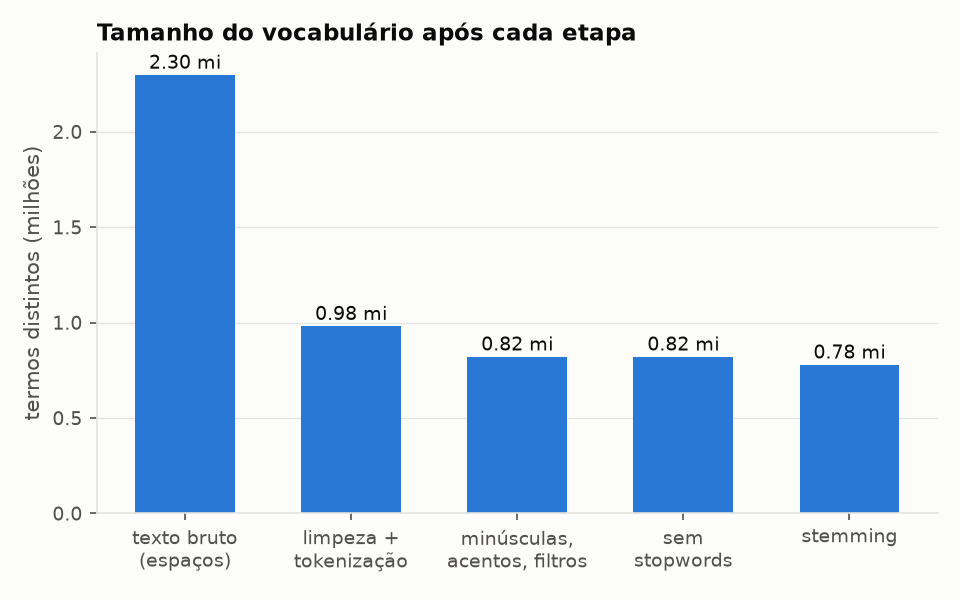
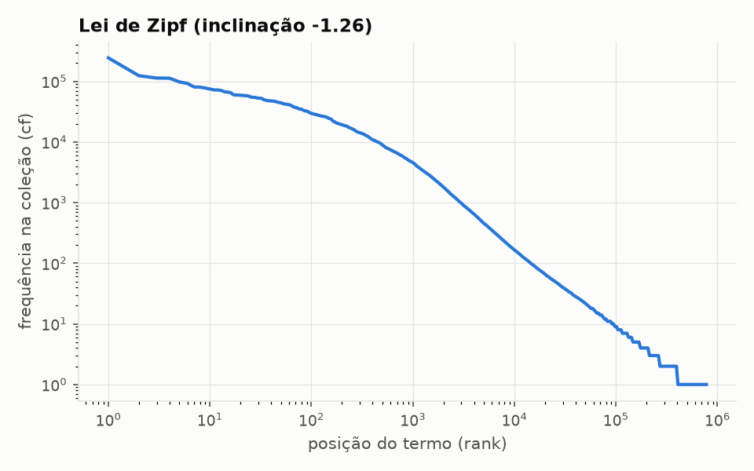
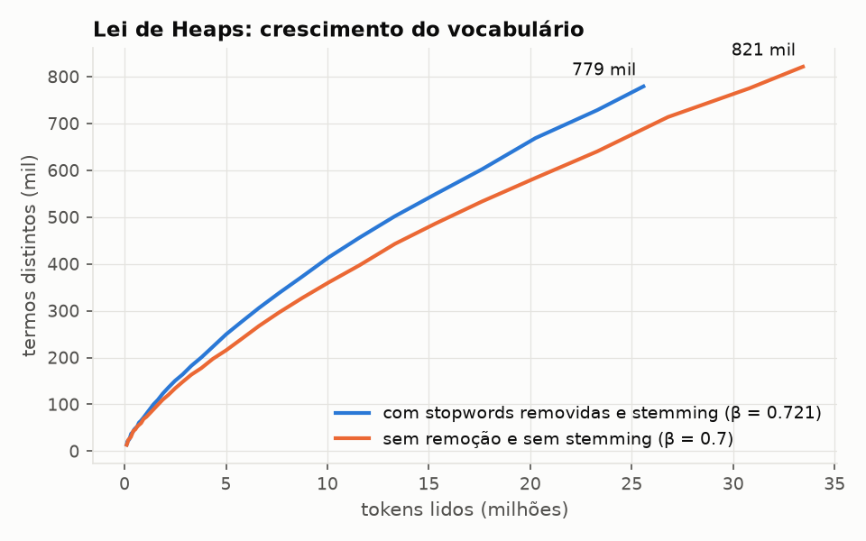
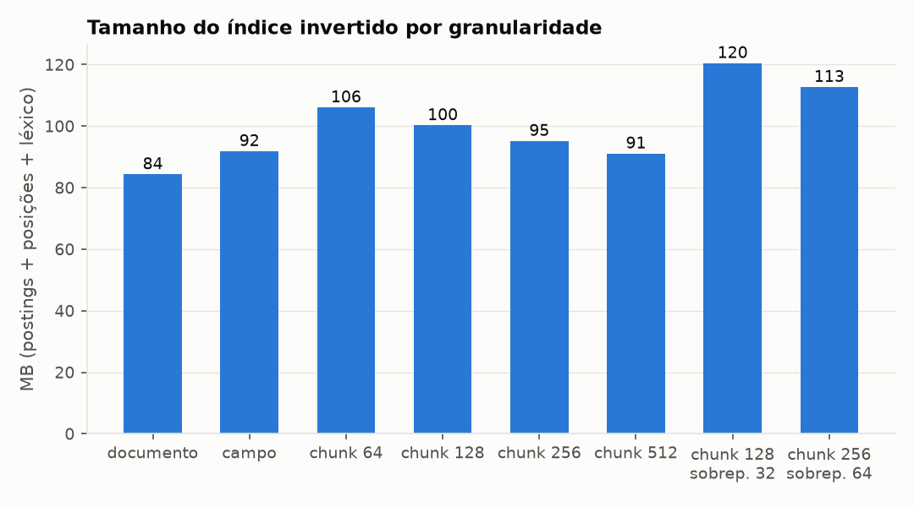
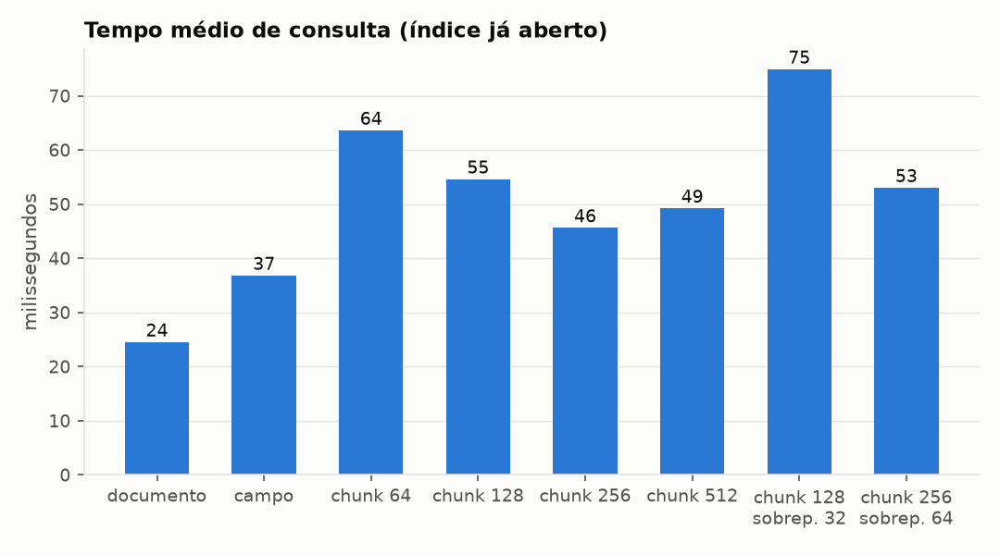
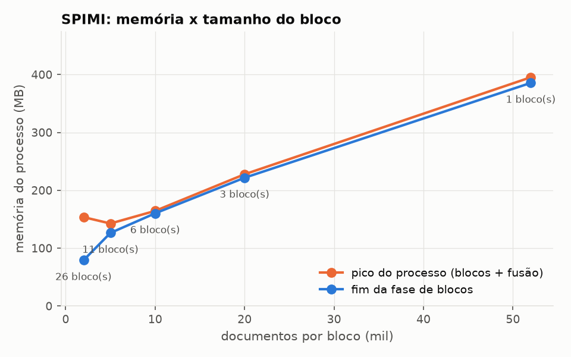

# Sistema de Recuperação da Informação, Parte 2: Representação e Indexação

**Tema:** busca de projetos de software livre
**Entrada:** `data/projetos.jsonl`, os 52.000 projetos coletados na Parte 1 (26.000 do GitHub e 26.000 do SourceForge)
**Linguagem:** Python 3 (sem banco de dados)
**Grupo:** Camila de Paula Rodrigues, Daniela da Silva Lopes, Luísa Ferreira Marques, Luisa Sapori e Thiago Lacerda Santos Barbosa

---

## 📌 1. Resumo da etapa

Nesta etapa transformamos os 52.000 projetos coletados num **índice
invertido** próprio, gravado em arquivos, e medimos como cada escolha da
representação afeta o tempo, a memória e o espaço.

| O que foi feito | Onde |
|-----------------|------|
| Limpeza dos dados: URLs, HTML, entidades, emojis, caracteres invisíveis, hashes | `indexador/limpeza.py`, seção 3.2 |
| Análise léxica: tokenização, termos técnicos (c++, c#, .net), compostos, camelCase, bigramas para chinês/japonês/coreano, minúsculas e acentos | `indexador/analisador.py`, seção 3.3 |
| Remoção de stopwords (inglês e português) e stemming Snowball | seções 3.4 e 3.5 |
| Índice invertido posicional, com a frequência de cada campo, construído com SPIMI e comprimido com gaps + Variable Byte | `indexador/construtor.py`, seção 4 |
| Leitura do índice e uma busca BM25F provisória, para validar o índice | `indexador/indice.py`, `indexador/busca.py` |
| Testes que comparam o índice com um cálculo por força bruta | `tests/test_indexador.py`, seção 4.7 |
| Análise de hiperparâmetros: granularidade, tamanho do chunk, sobreposição, posições, stopwords, stemming, tamanho do bloco e número de partições (buckets) | `experimentos_indexacao.py`, seção 5 |

**Números do índice escolhido** (granularidade por campo, com posições):

| Medida | Valor |
|--------|-------|
| Documentos indexados | 52.000 |
| Tokens antes / depois do pré-processamento | 32,8 milhões / 25,6 milhões |
| Vocabulário (termos distintos) | 779.148 |
| Postings (pares termo-documento) | 9.783.738 |
| Tempo total de indexação | 97,8 s (8 núcleos), incluindo o pré-processamento |
| Memória de pico do processo principal | 216 MB |
| Índice invertido (postings + posições + léxico) | 91,8 MB, contra 233 MB do `projetos.jsonl` |
| Listas de postings e posições | 66,8 MB comprimidas, contra 183,6 MB sem compressão (36%) |

---

## 🚫 2. Sem banco de dados

O enunciado proíbe bancos de dados ACID nesta etapa. O indexador **não usa
nenhum banco de dados**, nem relacional nem NoSQL:

- a entrada é o arquivo `data/projetos.jsonl`, lido linha a linha;
- o índice é um conjunto de arquivos binários e de texto, num formato
  definido por nós (seção 4.1), escritos e lidos pelo próprio programa com
  `open`, `seek` e `read`.

O SQLite (`data/coletor.db`) continua existindo, mas é usado só pelo coletor
da Parte 1, para guardar a fila e permitir a retomada da coleta. O indexador
nunca abre esse arquivo. Por isso não foi preciso pedir autorização para
nenhuma tecnologia NoSQL.

---

## 🧹 3. Pré-processamento

### 3.1 Documento e campos

O documento continua sendo a página de um projeto, como na Parte 1. Os dois
sites têm campos diferentes, então reunimos o texto em quatro **campos**
comuns (`indexador/documentos.py`):

| Campo | GitHub | SourceForge |
|-------|--------|-------------|
| `nome` | nome do repositório e dono | nome do projeto |
| `descricao` | descrição ("About") | descrição e resumo |
| `rotulos` | tópicos e linguagem | categorias e linguagem |
| `readme` | texto do README | (não existe) |

Os campos estruturados (linguagem, licença, tópicos, estrelas, forks,
downloads, nota, data) vão para a tabela de documentos do índice
(`documentos.jsonl`). Eles não entram no texto (exceto linguagem, tópicos e
categorias, que também são palavras que o usuário digita: "python",
"emulator"), mas ficam guardados para servir de filtro e de sinal de
popularidade na etapa 3.

**A coleção é muito desequilibrada.** Depois do pré-processamento, um
projeto do GitHub tem em média **939 termos** (quase todos do README) e um
do SourceForge tem **44**. É 21 vezes mais texto. Esse desequilíbrio é o
principal motivo para testar granularidades diferentes (seção 5.2): com o
documento inteiro como unidade, o README domina a representação.

### 3.2 Limpeza dos dados

Antes de definir as regras, medimos o ruído no texto dos 52.000 projetos:

| Ruído | Ocorrências | Problema que causa |
|-------|-------------|--------------------|
| URLs | 85.874 | termos como `githubusercontent`, `shields`, `badge` em milhares de READMEs |
| Etiquetas HTML que sobraram no README (``, `<a href>`, `<details>`) | 32.552 | termos `img`, `src`, `href`, `png` |
| Emojis e símbolos | 196.407 | nenhum valor para a busca |
| Caracteres de largura zero (U+200B, U+200D) | presentes em vários READMEs | partem palavras ao meio: `file​name` vira `file` + `name` |
| Entidades HTML (`&amp;`, `&#39;`) | 432 | termos `amp`, `39` |
| Caracteres chineses, japoneses e coreanos | 4,1 milhões (2.495 projetos com mais de 50) | sem espaço entre as palavras |
| Sequências hexadecimais de 20 ou mais caracteres (hashes) | 3.037 | termos únicos que só aumentam o vocabulário |

Regras de limpeza (`indexador/limpeza.py`), na ordem:

1. converte as entidades HTML (`&amp;` → `&`);
2. normaliza o Unicode com **NFKC**, que junta formas equivalentes:
   ligaduras (`fi` → `fi`), letras de largura total usadas em textos em
   japonês (`Ｐｙｔｈｏｎ` → `Python`) e números sobrescritos;
3. remove os caracteres invisíveis (largura zero, hífen condicional);
4. remove URLs e e-mails;
5. remove as etiquetas HTML conhecidas. Usamos uma lista de etiquetas, e não
   um padrão genérico `<...>`, porque o padrão genérico apagaria texto útil
   dos exemplos de código, como `List<String>`.

Emojis e símbolos não precisam de regra: o tokenizador só aceita letras e
dígitos. Hashes, números longos e lixo são tratados pelos filtros da
análise léxica (seção 3.3).

### 3.3 Análise léxica

`indexador/analisador.py`. Cada regra resolve um problema que encontramos
no texto real:

1. **Termos técnicos com símbolos.** Antes de tokenizar, `c++` vira `cpp`,
   `c#` vira `csharp`, `f#` vira `fsharp`, `.net` vira `dotnet`, `asp.net`
   vira `aspnet`, `objective-c` vira `objectivec` e `xxx.js` vira `xxxjs`
   (`node.js` → `nodejs`). Sem essa regra, `c++` e `c#` virariam a letra `c`
   (a linguagem C) e `node.js` viraria `node` + `js`. Escolhemos os mesmos
   nomes usados nos tópicos do GitHub (`cpp`, `csharp`, `dotnet`, `nodejs`),
   então o termo do README e o tópico viram o mesmo termo. Na coleção há
   12.707 ocorrências de `c++`, 6.649 de `node.js`, 6.019 de `.net` e 4.358
   de `c#`. O `c++` também é reconhecido colado à versão: `C++17` →
   `cpp` + `17`.
2. **Tokenização.** Um token é uma sequência de letras e dígitos de
   qualquer alfabeto. Sequências unidas por `-`, `_`, `.` ou apóstrofo
   formam um token composto, que é quebrado nas partes: `tcp-server` →
   `tcp`, `server`; `num_workers` → `num`, `workers`. Assim a consulta
   "machine learning" encontra o tópico `machine-learning`.
3. **camelCase só no nome.** No campo `nome`, quebramos camelCase e também
   guardamos a forma unida: `FileWizardAI` → `filewizardai`, `file`,
   `wizard`, `ai`; `system-design-primer` → `systemdesignprimer`, `system`,
   `design`, `primer`. Nos outros campos não quebramos camelCase, porque
   nomes de produtos seriam partidos (`JavaScript` viraria `java` +
   `script`, e a consulta "java" traria projetos JavaScript).
4. **Chinês, japonês e coreano** não separam as palavras com espaço. Cada
   sequência desses caracteres vira **bigramas** de caracteres
   (`简体中文` → `简体`, `体中`, `中文`), a mesma solução do CJKAnalyzer do
   Lucene. Sem isso, uma frase inteira viraria um único token.
5. **Normalização:** minúsculas (`casefold`) e remoção de acentos
   (`Português` → `portugues`), para que a consulta com ou sem acento
   encontre o mesmo termo.
6. **Filtros:** descartamos tokens com menos de 2 caracteres (exceto `c` e
   `r`, nomes de linguagens), com mais de 25 (hashes, base64, lixo) e
   números puros com mais de 4 dígitos (ids, telefones). Números curtos,
   como anos e versões (`2024`, `v2`, `3d`), ficam.

### 3.4 Stopwords

Usamos a lista de stopwords do inglês do NLTK (a mesma do Snowball) e uma
lista das palavras gramaticais mais comuns do português, já sem acento
(`indexador/stopwords.py`). O texto é quase todo em inglês, mas o sistema
é feito para usuários brasileiros, que podem consultar em português ("editor
de video"). Como a consulta passa pelo mesmo analisador, as palavras
gramaticais do português também precisam sair.

Tiramos da lista do português palavras que também são termos técnicos em
inglês nos READMEs: `num` (`num_workers`), `eu`, `sem`, `tem` e `ate`.

**Stopwords do domínio.** Também avaliamos remover palavras muito comuns
nesta coleção, como `use`, `project`, `support` e `instal` (seção 3.7).
Decidimos **não** removê-las: elas fazem parte de consultas reais ("install
manager", "project management") e o IDF do modelo de recuperação já reduz o
peso delas.

### 3.5 Stemming

Usamos o **Snowball para inglês** (Porter2), da biblioteca
`snowballstemmer`, escolhido por ser a versão revisada do algoritmo de
Porter visto em aula. Exemplos: `running`, `runs` → `run`; `libraries` →
`librari`; `application` → `applic`.

Cuidados que só apareceram nos testes:

- o stemmer só é aplicado a palavras ASCII sem dígitos. Termos de outros
  alfabetos e tokens como `v2` ou `3d` ficam como estão;
- os termos técnicos da seção 3.3 ficam fora do stemming, porque o stemmer
  os estragava: `nodejs` → `nodej`, `macos` → `maco` e, pior, `ios` → `io`,
  que se confundiria com I/O.

O resultado de cada token (normalização, filtros, stopwords e stemming)
fica num cache em memória: o vocabulário é muito menor que o número de
tokens, então cada palavra distinta só é processada uma vez.

### 3.6 Exemplo passo a passo

Descrição do projeto `keepassxreboot/keepassxc`:

> KeePassXC is a cross-platform community-driven port of the Windows application “KeePass Password Safe”.

| Etapa | Saída |
|-------|-------|
| texto bruto (separado por espaços) | `KeePassXC` `is` `a` `cross-platform` `community-driven` `port` `of` `the` `Windows` `application` `“KeePass` `Password` `Safe”.` |
| limpeza e tokenização | `KeePassXC` `is` `a` `cross` `platform` `community` `driven` `port` `of` `the` `Windows` `application` `KeePass` `Password` `Safe` |
| minúsculas, acentos e filtros | `keepassxc` `is` `cross` `platform` `community` `driven` `port` `of` `the` `windows` `application` `keepass` `password` `safe` |
| sem stopwords | `keepassxc` `cross` `platform` `community` `driven` `port` `windows` `application` `keepass` `password` `safe` |
| stemming | `keepassxc` `cross` `platform` `communiti` `driven` `port` `window` `applic` `keepass` `password` `safe` |

Um trecho inventado para mostrar as outras regras:

> Supports C++17 & C#; see https://keepassxc.org/docs 🔐 KeePassXC’s auto-type works on Linux, macOS and Windows.

→ `support` `cpp` `17` `csharp` `see` `keepassxc` `auto` `type` `work` `linux` `macos` `window`

A URL e o emoji sumiram, `C++17` e `C#` viraram termos técnicos, `auto-type`
foi quebrado e `macos` foi protegido do stemming.

### 3.7 Efeito de cada etapa na coleção

Medido sobre os 52.000 projetos (`python experimentos_indexacao.py preprocessamento`):

| Etapa | Tokens | Vocabulário | Variação do vocabulário |
|-------|-------:|------------:|------------------------:|
| texto bruto (separado por espaços) | 32.801.954 | 2.297.831 | |
| limpeza + tokenização | 35.064.058 | 981.255 | −57,3% |
| minúsculas, acentos e filtros | 33.436.005 | 821.248 | −16,3% |
| remoção de stopwords | 25.575.077 | 821.022 | −0,03% |
| stemming | 25.575.077 | 779.148 | −5,1% |



O que os números mostram:

- **A limpeza e a tokenização são a etapa que mais reduz o vocabulário**
  (−57%). No texto bruto, `Linux`, `Linux,`, `(Linux)` e `linux.` são termos
  diferentes, e cada URL é um termo único. O número de tokens *aumenta*,
  porque os compostos são quebrados (`cross-platform` → 2 tokens) e o texto
  em chinês, japonês e coreano vira bigramas.
- **As stopwords quase não mudam o vocabulário, mas tiram 23,5% dos
  tokens.** São só ~200 palavras, mas são as mais frequentes. É isso que
  reduz o tamanho das postings e das posições (seção 5.4).
- **O stemming reduz o vocabulário em só 5,1%.** Parece pouco porque a maior
  parte do vocabulário não é inglês comum: são nomes de projetos,
  identificadores de código, palavras de outras línguas e termos que
  aparecem uma vez só (64,9% do vocabulário tem df = 1, seção 3.8). Nas
  palavras comuns o efeito é grande: no SourceForge, onde o texto é mais
  "limpo", o vocabulário cai 16,5% (de 68.240 para 57.001).

### 3.8 Leis de Zipf e de Heaps

`python experimentos_indexacao.py zipf_heaps`, sobre o índice escolhido.

**Zipf.** A frequência de um termo na coleção (cf) cai com a sua posição
no ranking de frequência. Em escala log-log, a curva é quase uma reta, com
inclinação **−1,26** (ajuste entre as posições 10 e 10.000; a lei de Zipf
ideal tem −1). O termo mais frequente aparece 243.337 vezes; o da posição
1.000, 4.558 vezes; o da posição 10.000, 166 vezes. A partir da posição
~400 mil, todos aparecem uma vez só.



**A cauda é enorme:** 505.433 termos (**64,9% do vocabulário**) aparecem
num único documento (df = 1). São nomes de projetos e de pessoas,
identificadores de código, palavras de outras línguas e erros de digitação.
Duas consequências para o índice: a maior parte do léxico é de termos com
listas de 1 entrada (poucos bytes de postings, mas uma linha inteira no
léxico, o que explica o léxico ocupar 27% do índice); e carregar o léxico
inteiro é caro, o que motiva as partições (seção 5.6).

**Heaps.** O vocabulário V cresce com o número de tokens T como
V = K · T^β. Ajustando aos pontos medidos durante a leitura da coleção:

| Variante | K | β | Vocabulário final |
|----------|--:|--:|------------------:|
| com stopwords removidas e stemming (índice escolhido) | 3,6 | 0,72 | 779.148 |
| sem remoção de stopwords e sem stemming | 4,5 | 0,70 | 821.248 |



O β de textos comuns em inglês fica entre 0,4 e 0,6. O nosso é maior porque
os READMEs têm identificadores de código, nomes e trechos em muitas línguas:
o vocabulário não satura com 52 mil documentos. Dobrar a coleção aumentaria
o vocabulário em cerca de 2^0,72 ≈ 1,65 vez. (A curva azul fica acima da
laranja porque, sem as stopwords, o mesmo vocabulário aparece com menos
tokens lidos.)

**Termos mais comuns.** Os termos com maior df são palavras gerais do
domínio de software: `use` (em 58,1% dos projetos), `support` (39,9%),
`file` (39,0%), `project` (38,7%), `instal` (36,0%), `run` (35,8%),
`code` (35,5%), `develop` (35,3%), `sourc` (34,0%), `open` (33,4%). São
as candidatas a "stopwords do domínio" discutidas na seção 3.4; a lista dos
40 primeiros está em `evidencias/indexacao/zipf_heaps.json`.

---

## 🗂️ 4. O índice invertido

### 4.1 Estrutura

```
                              data/indice/
   léxico (texto)                  postings (binário)            posições (binário)
   lexico_007.tsv                  postings_007.bin              posicoes_007.bin
  +--------------------------+    +------------------------+    +-----------------------+
  | termo  df  cf  off  n ...|--->| gap | máscara | tf ... |    | gaps das posições ... |
  | python 10404 52488 ...   |    | gap | máscara | tf ... |    |                       |
  +--------------------------+    +------------------------+    +-----------------------+
            ^ partição = crc32(termo) mod 16
   documentos.jsonl : metadados de cada projeto (url, site, nome, linguagem, licença, estrelas...)
   comprimentos.bin : número de termos de cada documento em cada campo (para a normalização)
   meta.json        : configuração, estatísticas, tempos e tamanhos
```

| Arquivo | Conteúdo |
|---------|----------|
| `lexico_XXX.tsv` | uma linha por termo: termo, df (número de documentos), cf (ocorrências na coleção), posição e tamanho da lista de postings e da lista de posições |
| `postings_XXX.bin` | a lista de postings de cada termo, uma depois da outra, comprimida |
| `posicoes_XXX.bin` | as posições de cada ocorrência, comprimidas |
| `documentos.jsonl` | os metadados de cada projeto, na ordem do docid |
| `comprimentos.bin` | vetor de inteiros de 32 bits: número de termos de cada unidade em cada campo |
| `unidades.bin` | só na granularidade chunk: o projeto (docid) de cada unidade |
| `meta.json` | configuração usada, estatísticas, tempos e tamanhos |

O docid é o número da linha do projeto no `projetos.jsonl`.

**Formato de uma entrada da lista de postings** (granularidade por campo):

```
gap do docid (VB) | máscara de campos (1 byte) | tf de cada campo presente (VB)
```

A máscara tem um bit por campo (nome = 1, descricao = 2, rotulos = 4,
readme = 8) e diz em quais campos o termo aparece. Só as frequências desses
campos são gravadas. Assim, a mesma lista serve para uma busca no documento
inteiro (somando as frequências) e para uma busca que dá pesos diferentes
a cada campo (BM25F, etapa 3), sem precisar de um índice por campo.

**As posições ficam num arquivo separado.** Para cada entrada e para cada
campo presente, são gravadas as `tf` posições do termo naquele campo (a
contagem começa em 0 em cada campo), como gaps. Separar as posições, como
faz o Lucene, tem duas vantagens: a consulta comum (sem frase) lê e
decodifica só as postings, que têm menos da metade do tamanho; e o custo
das posições aparece separado nas medições.

### 4.2 Construção com SPIMI

O índice é construído com o **SPIMI** (Single-Pass In-Memory Indexing),
visto em aula:

1. **Análise em paralelo.** Sete processos auxiliares leem as linhas do
   JSONL e devolvem os termos de cada campo. O processo principal recebe os
   documentos na ordem do arquivo e só monta o índice. Há um limite de
   lotes pendentes, para a análise não encher a memória quando corre mais
   rápido que a indexação.
2. **Blocos.** O processo principal mantém um dicionário em memória
   `termo → postings já comprimidas` (um `bytearray` por termo), sem ordenar
   nada durante a leitura. A cada `documentos_por_bloco` documentos (padrão
   10.000), os termos do bloco são ordenados e gravados num arquivo
   temporário (`_blocos/bloco_0001.run`), e a memória é liberada.
3. **Fusão.** Os blocos são lidos ao mesmo tempo, em ordem alfabética de
   termo (fusão de k vias com `heapq.merge`). As listas de um termo são
   emendadas na ordem dos blocos, que é a ordem dos docids. O primeiro docid
   de cada bloco está gravado como número absoluto e, na emenda, vira um gap
   em relação ao último docid do bloco anterior.
4. **Partições.** Na fusão, cada termo vai para uma das `particoes`
   (buckets) do índice final: `crc32(termo) mod particoes`.

Como cada bloco é gravado já ordenado e a fusão só lê os blocos em
sequência, a memória da construção depende do tamanho do bloco, e não do
tamanho da coleção (seção 5.5).

### 4.3 Compressão: gaps + Variable Byte

Gravamos as **diferenças (gaps)** entre docids consecutivos, e não os
docids, e cada número é codificado com **Variable Byte** (VB), como no
capítulo 5 do livro do Manning: blocos de 7 bits, com o bit mais alto
ligado só no último byte do número. Números menores que 128 ocupam 1 byte;
menores que 16.384, 2 bytes. As posições também são gravadas como gaps.

Exemplo real, o início da lista do termo `python` (df = 10.404):

```
bytes:   81 | 0c | 82 82 | 82 | 0f | 81 81 85 02 8d | ...
         gap=1  máscara  tf=2 tf=2  gap=2  máscara  tf=1 tf=1 tf=5 tf=269
               (rotulos+readme)           (os 4 campos)
```

O projeto 1 tem `python` duas vezes nos rótulos e duas no README; o projeto
3 (docid 1 + 2) tem nos quatro campos, 269 vezes no README (269 = 2 × 128 +
13 ocupa 2 bytes: `02 8d`). Nos termos frequentes os gaps são pequenos: em
`python`, 100% dos gaps cabem em 1 byte, e a entrada média ocupa 3,6 bytes
com as frequências dos campos. Num termo raro como `keepass` (df = 56), os
gaps são grandes e 71% deles ocupam 2 bytes ou mais.

**Resultado:** as listas de postings e posições ocupam 66,8 MB, contra
183,6 MB se cada número fosse gravado em 4 bytes, ou seja, **36% do tamanho
sem compressão**.

### 4.4 Partições (buckets) do índice final

O índice final é dividido em `P` partições pelo hash do termo. Cada partição
tem o seu léxico, as suas postings e as suas posições. Para responder uma
consulta, o programa só carrega o léxico das partições dos termos da
consulta, e não o léxico inteiro (779 mil termos). O número de partições é
um hiperparâmetro, analisado na seção 5.6.

### 4.5 Leitura do índice

`indexador/indice.py`. Ao abrir o índice, carrega `meta.json`,
`comprimentos.bin` e a tabela de documentos. O léxico de cada partição só é
carregado na primeira vez que uma consulta usa um termo daquela partição.
As postings e as posições de um termo são lidas do disco com `seek` + `read`,
só os bytes do termo, e decodificadas.

### 4.6 Busca de validação

Para verificar que o índice responde consultas de verdade, implementamos uma
busca ranqueada simples (`indexador/busca.py`, `python buscar.py "consulta"`):

- BM25F na granularidade por campo, com pesos provisórios nome 3,
  descrição 2, rótulos 2 e README 1 (k1 = 1,2; b = 0,75);
- BM25 na granularidade por documento;
- na granularidade chunk, BM25 em cada unidade, e a nota do projeto é a da
  sua melhor unidade (MaxP).

A consulta passa pelo mesmo analisador dos documentos. Exemplo:

```
$ python buscar.py "password manager linux" --k 5
consulta: 'password manager linux' -> termos ['password', 'manag', 'linux']
 1.   5.12  [github     ] pass-winmenu  https://github.com/geluk/pass-winmenu
 2.   4.99  [github     ] keepassxc  https://github.com/keepassxreboot/keepassxc
 3.   4.90  [sourceforge] fpwdman Password Manager  https://sourceforge.net/projects/fpwdman/
 4.   4.84  [github     ] wifi-password  https://github.com/sdushantha/wifi-password
 5.   4.79  [github     ] ovpn-admin  https://github.com/palark/ovpn-admin
```

Os resultados fazem sentido, mas o ranqueamento ainda não foi calibrado nem
avaliado (`wifi-password` e `ovpn-admin` não são gerenciadores de senha).
Isso é o trabalho da etapa 3 (seção 8).

### 4.7 Testes de correção

`python -m unittest discover -s tests -v` roda 12 testes:

- **compressão VB:** ida e volta de 5.000 números, os limites 127/128 e
  16.383/16.384, e os exemplos do livro (5 → `85`, 824 → `06 b8`);
- **analisador:** termos técnicos, limpeza, invisíveis e largura total,
  compostos e camelCase, ideogramas e acentos, filtros e stopwords;
- **índice contra força bruta:** constrói o índice dos 400 primeiros
  projetos em blocos de 97 documentos e 7 partições (para exercitar a fusão
  e as partições) e compara, **termo a termo**, as unidades, as frequências
  por campo, as posições, o df e o cf com o resultado calculado diretamente
  dos termos de cada documento. O teste roda nas três granularidades
  (campo; documento sem posições; chunk de 50 termos com sobreposição 10).

Todos passam.

---

## 🔬 5. Análise de hiperparâmetros da representação

### 5.1 Metodologia

`python experimentos_indexacao.py tudo`. Todos os números estão em
`evidencias/indexacao/configuracoes.csv`.

- **Uma variável por vez.** A configuração base é: granularidade por campo,
  com posições, com remoção de stopwords e stemming, blocos de 10.000
  documentos e 16 partições. Cada experimento muda só um hiperparâmetro.
- **A coleção inteira.** Todas as configurações foram construídas com os
  52.000 projetos, e não com uma amostra.
- **Análise uma vez só.** O pré-processamento de cada variante (com e sem
  stopwords, com e sem stemming) é feito uma vez e gravado num cache. Cada
  configuração é construída a partir do cache, **num processo separado**,
  para que a memória de pico de uma não contamine a da outra. Por isso os
  tempos desta seção (cerca de 60 a 80 s) medem só a construção do índice;
  o tempo do pré-processamento está na seção 6.
- **Consultas.** As 30 consultas da lista `CONSULTAS` do script (25 em
  inglês e 5 em português, como "password manager linux", "c++ game
  engine" e "editor de video"), respondidas com a busca de validação (seção
  4.6), top-10. Medimos o tempo **a frio** (índice recém-aberto a cada
  consulta, sem léxico em memória: mede o custo de carregar o léxico) e
  **a quente** (índice aberto e já usado: mede a leitura e decodificação das
  postings e o cálculo das notas).
- **Dois diagnósticos do ranqueamento, que não são medidas de qualidade:**
  a porcentagem de projetos do SourceForge no top-10 (a coleção tem 50% de
  cada site) e a porcentagem do top-10 em comum com a configuração base.
  Eles mostram o quanto a representação muda a resposta, mas não se a
  resposta ficou melhor. A qualidade só pode ser medida com julgamentos de
  relevância, que são o primeiro passo da etapa 3 (seção 8).
- **Máquina:** Windows 11, 8 núcleos, Python 3.14. Duas construções
  idênticas do índice principal levaram 91,4 s e 97,8 s. Diferenças de
  tempo menores que ~10% não devem ser interpretadas.

### 5.2 Granularidade e tamanho do chunk

A **granularidade** define o que é uma unidade do índice, ou seja, o que
uma posting aponta:

- **documento:** o projeto inteiro, com todos os campos juntos;
- **campo:** o projeto inteiro, mas com a frequência de cada campo separada
  na posting (seção 4.1);
- **chunk:** o README é cortado em janelas de N termos (o tamanho do chunk),
  com ou sem sobreposição entre janelas vizinhas; o cabeçalho (nome,
  descrição, rótulos) é mais uma unidade. A nota do projeto é a da sua
  melhor unidade.

| Configuração | Unidades | Postings (milhões) | Postings (MB) | Posições (MB) | Índice (MB) | Consulta a quente | SourceForge no top-10 | Top-10 em comum com "campo" |
|---|---:|---:|---:|---:|---:|---:|---:|---:|
| documento | 52.000 | 9,78 | 22,0 | 37,3 | 84,3 | 24,5 ms | 47,7% | 59,3% |
| **campo** | 52.000 | 9,78 | 31,9 | 34,9 | 91,8 | 36,8 ms | 15,3% | 100% |
| chunk 64 | 434.481 | 18,40 | 41,7 | 39,1 | 106,0 | 63,6 ms | 28,3% | 49,3% |
| chunk 128 | 249.809 | 16,67 | 37,4 | 37,7 | 100,2 | 54,6 ms | 33,7% | 50,0% |
| chunk 256 | 157.681 | 15,01 | 33,5 | 36,5 | 95,1 | 45,6 ms | 37,0% | 48,3% |
| chunk 512 | 112.113 | 13,47 | 30,1 | 35,9 | 91,1 | 49,2 ms | 41,7% | 45,7% |
| chunk 128, sobreposição 32 | 303.364 | 21,29 | 46,5 | 48,4 | 120,4 | 74,9 ms | 31,7% | 50,3% |
| chunk 256, sobreposição 64 | 180.800 | 18,74 | 40,8 | 46,5 | 112,7 | 53,0 ms | 36,7% | 48,3% |





**Documento × campo.** As duas têm exatamente as mesmas 9,78 milhões de
postings. Separar os campos custa 9,9 MB a mais nas postings (+45%), por
causa da máscara e de até quatro frequências por entrada, e deixa a
consulta 50% mais lenta (24,5 → 36,8 ms), porque cada entrada tem mais
números para decodificar e a nota soma os campos. As posições ficam um
pouco *menores* por campo (34,9 contra 37,3 MB), porque a contagem
recomeça em cada campo e os números são menores. Em troca, a
representação por campo permite dar pesos diferentes ao nome, à descrição,
aos rótulos e ao README (BM25F), buscar uma frase dentro de um campo e
restringir a busca a um campo.

**A granularidade muda quem aparece no topo.** Só 59% do top-10 é igual
entre documento e campo, e a participação do SourceForge vai de 47,7% para
15,3%. O motivo é o desequilíbrio da coleção (seção 3.1): com o documento
inteiro, o BM25 normaliza pelo comprimento médio da coleção (492 termos), e
um projeto do SourceForge (44 termos) é muito mais curto que a média, o
que aumenta a nota de cada termo encontrado. Por campo, cada campo é
comparado com a média do próprio campo, e o projeto do GitHub ainda soma a
evidência do README. Nenhum dos dois números está "certo": os julgamentos
de relevância da etapa 3 vão dizer qual ordenação é melhor.

**Tamanho do chunk.** Quanto menor o chunk, mais unidades (de 112 mil com
512 termos para 434 mil com 64) e mais postings (de 13,5 para 18,4
milhões): um termo que aparece várias vezes no README passa a ter uma
posting em cada chunk onde aparece, em vez de uma só no projeto. O índice
cresce até 106 MB e a consulta fica mais lenta (até 64 ms), porque as
listas são mais longas e as notas das unidades precisam ser agregadas por
projeto. Com chunks de 512 termos o índice tem o mesmo tamanho do índice
por campo. As posições quase não mudam, porque o número de ocorrências é o
mesmo.

**Sobreposição.** Repetir 25% dos termos entre chunks vizinhos aumenta as
unidades em 15 a 21%, as postings em 25 a 28% e o índice em 18 a 20%. Com
chunk 128, a consulta fica 37% mais lenta (54,6 → 74,9 ms). A sobreposição
só se justificaria se a avaliação mostrasse que as frases cortadas na
fronteira entre chunks fazem perder resultados relevantes.

**Chunk e ranqueamento.** Com chunks, o SourceForge fica entre os dois
extremos (28 a 42% do top-10). Cada janela do README compete com o
cabeçalho do projeto do SourceForge em pé de igualdade de tamanho. Com
chunks pequenos, porém, um projeto do GitHub tem dezenas de unidades e
basta uma delas ir bem (MaxP), o que explica o SourceForge cair para 28%
com chunks de 64 termos.

**Decisão:** granularidade **por campo**. É a menor representação que
guarda a informação de campo, e a etapa 3 precisa dela para o BM25F,
porque o nome e os rótulos são muito mais informativos que uma linha
qualquer do README. Os chunks custam até 15% a mais de espaço e até 73% a
mais de tempo de consulta. Não descartamos os chunks: **chunk 256 sem
sobreposição** é o candidato a comparar na etapa 3. É o tamanho que menos
custa entre os que ainda cortam a maioria dos READMEs: depois do
pré-processamento, o README de um projeto do GitHub tem em média 910
termos (mediana 470), 70% passam de 256 termos e 10% passam de 2.000. Além disso, o melhor chunk de um projeto é
um bom trecho para mostrar no resultado.

### 5.3 Posições

| Configuração | Índice com posições | Sem posições | Redução | Construção com / sem | Consulta a quente com / sem |
|---|---:|---:|---:|---:|---:|
| documento | 84,3 MB | 42,6 MB | −49% | 60,2 s / 49,1 s | 24,5 / 24,5 ms |
| campo | 91,8 MB | 52,6 MB | −43% | 63,7 s / 55,5 s | 36,8 / 36,1 ms |

As posições são **quase metade do índice** e 13 a 18% do tempo de
construção, mas **não custam nada na consulta comum**, porque ficam num
arquivo separado (seção 4.1) que a consulta sem frase nem abre.

**Decisão:** manter as posições. Elas permitem a consulta por frase
("static site generator", "pdf to text") e a escolha do trecho mostrado no
resultado, ambas previstas para a etapa 3. O custo é só espaço em disco
(39 MB).

### 5.4 Stopwords e stemming

| Variante | Vocabulário | Postings (milhões) | Posições (MB) | Índice (MB) | Construção | Consulta a quente | Top-10 em comum com a base |
|---|---:|---:|---:|---:|---:|---:|---:|
| **base (remove stopwords, com stemming)** | 779.148 | 9,78 | 34,9 | 91,8 | 63,7 s | 36,8 ms | 100% |
| sem remover stopwords | 779.258 | 11,12 | 45,4 | 106,3 | 73,7 s | 47,2 ms | 85,3% |
| sem stemming | 821.022 | 10,92 | 35,7 | 98,1 | 68,0 s | 27,1 ms | 71,3% |
| sem os dois | 821.248 | 12,28 | 46,2 | 112,6 | 83,3 s | 39,9 ms | 66,0% |

**Stopwords.** Mantê-las aumenta as postings em 14% e as posições em 30%,
porque elas aparecem muitas vezes em cada documento (31% a mais de tokens).
O índice cresce 16%, e a consulta fica 28% mais lenta: consultas como
"python library **to** read pdf" e "editor **de** video" passam a ler listas
com dezenas de milhares de entradas. O ranqueamento muda pouco (85% do
top-10 igual), porque o IDF já dá peso quase zero a essas palavras.

**Stemming.** Sem stemming o vocabulário cresce 5,4% e as postings 11,6%:
`manager`, `managers`, `manage` e `managed` viram listas separadas, e um
projeto que usa duas formas aparece nas duas listas. O índice fica 7% maior.
Mesmo assim, **a consulta fica mais rápida sem stemming** (27,1 contra 36,8
ms). Com stemming, o termo da consulta (`manag`) é a união de todas as
formas e tem uma lista mais longa que cada forma sozinha. O stemming é a
escolha que **mais muda o ranqueamento**: 29% do top-10 muda. Também é a
etapa mais cara do pré-processamento: a análise leva 67,8 s com stemming e
53,6 s sem (+27%), mesmo com o cache por palavra.

**Decisão:** remover as stopwords (índice menor e consultas mais rápidas,
quase sem mudar a resposta) e manter o stemming, pela revocação: quem
procura "password manager" quer também os projetos que se descrevem como
"manage your passwords". Como o stemming muda 29% do top-10, o efeito dele
na qualidade será medido na etapa 3 (tarefa T4).

### 5.5 Tamanho do bloco SPIMI

| Documentos por bloco | Blocos | Memória no fim da fase de blocos | Pico do processo | Tempo da fusão | Tempo total |
|---:|---:|---:|---:|---:|---:|
| 2.000 | 26 | 79 MB | 154 MB | 8,3 s | 67,4 s |
| 5.000 | 11 | 126 MB | 143 MB | 7,1 s | 66,1 s |
| **10.000** | 6 | 160 MB | 164 MB | 6,0 s | 63,7 s |
| 20.000 | 3 | 222 MB | 228 MB | 5,5 s | 63,4 s |
| 52.000 (bloco único) | 1 | 386 MB | 395 MB | 4,3 s | 61,7 s |



- **A memória cresce linearmente com o bloco**, cerca de 6 MB a cada mil
  documentos. Com o bloco único (a coleção inteira em memória, sem SPIMI
  de verdade), o processo chega a 395 MB.
- **Abaixo de 10.000 documentos, o pico do processo para de cair** (143 a
  164 MB), porque passa a ser dominado por custos que não dependem do bloco:
  o interpretador, a tabela de comprimentos, os leitores e os buffers da
  fusão. Com blocos de 2.000, a fase de blocos usa só 79 MB, mas a fusão de
  26 arquivos usa mais que isso.
- **Mais blocos deixam a fusão mais lenta** (de 4,3 s com 1 bloco para 8,3 s
  com 26), mas o tempo total varia só 9%, dentro da variação entre
  execuções.
- **O índice final é idêntico (91,8 MB) em todos os casos.** Isso confirma,
  na coleção inteira, o que os testes confirmam em escala pequena: a fusão
  emenda as listas corretamente.

**Decisão:** blocos de **10.000 documentos**. A memória fica em ~160 MB com
só 6 arquivos temporários, e, ao contrário do bloco único, não depende do
tamanho da coleção: com 10 vezes mais projetos, o uso de memória seria o
mesmo. Blocos de 5.000 seriam igualmente bons.

### 5.6 Número de partições (buckets)

| Partições | Arquivos | Léxico (MB) | Índice (MB) | Construção | Consulta a frio | Consulta a quente |
|---:|---:|---:|---:|---:|---:|---:|
| 1 | 6 | 26,8 | 93,6 | 63,6 s | 1.500 ms | 35,5 ms |
| **16** | 51 | 25,1 | 91,8 | 63,7 s | 249 ms | 36,8 ms |
| 64 | 195 | 23,9 | 90,7 | 64,7 s | 94 ms | 35,4 ms |
| 256 | 771 | 23,1 | 89,8 | 68,4 s | 55 ms | 38,1 ms |

- **A partição só importa a frio.** Com uma partição, a primeira consulta
  precisa carregar os 779 mil termos do léxico: 1,5 s. Com 16, carrega só as
  partições dos 2 a 4 termos da consulta (cerca de 49 mil termos cada): 249
  ms. Com 256, 55 ms. Depois de carregado, o tempo é o mesmo (35 a 38 ms).
  Carregar o léxico inteiro leva de 1,3 a 1,8 s em qualquer configuração.
- **O custo é o número de arquivos** (3 por partição, mais 3 fixos) e um
  pouco mais de tempo na fusão, que mantém um buffer por partição.
- O léxico fica um pouco menor com mais partições, porque os offsets
  gravados em texto são números menores.

**Decisão:** **16 partições**. Na etapa 3 a interface vai manter o índice
aberto, e o custo a frio acontece uma vez só. Com 16 partições, essa
primeira consulta leva 0,25 s, e o índice tem 51 arquivos. Se o sistema
fosse usado só pela linha de comando, abrindo o índice a cada consulta, 64
partições seriam melhores (94 ms).

### 5.7 Configuração escolhida

| Hiperparâmetro | Valor | Seção |
|----------------|-------|-------|
| Granularidade | por campo (nome, descrição, rótulos, README) | 5.2 |
| Chunk | não usado; chunk 256 sem sobreposição fica como candidato para a etapa 3 | 5.2 |
| Posições | sim, em arquivo separado | 5.3 |
| Stopwords | inglês + português | 5.4 |
| Stemming | Snowball inglês, com termos técnicos protegidos | 5.4 |
| Bloco SPIMI | 10.000 documentos | 5.5 |
| Partições | 16 | 5.6 |
| Compressão | gaps + Variable Byte | 4.3 |

---

## ⏱️ 6. Tempo e espaço da indexação

Medido na construção do índice escolhido, a partir do `projetos.jsonl`
(`python run_indexador.py`; saída completa em
`evidencias/indexacao/indice_principal.txt`).

### 6.1 Tempo

| Etapa | Tempo |
|-------|------:|
| Pré-processamento sozinho (8 processos), para referência | 67,8 s |
| Pré-processamento em paralelo + construção dos 6 blocos | 90,8 s |
| Fusão dos blocos nas 16 partições | 7,0 s |
| **Total** | **97,8 s** |

São cerca de 530 projetos e 260 mil tokens por segundo.

**Paralelismo.** Nos 10.000 primeiros projetos, só o pré-processamento
leva 41,6 s com 1 processo e 17,0 s com 8, ou seja, 2,4 vezes mais rápido, e
não 7 ou 8 vezes. O processo principal lê o arquivo, envia as linhas e
recebe os termos de volta, e essa comunicação entre processos tem custo.
Na construção completa, o gargalo é a montagem do índice, que acontece num
único processo: construída a partir do cache, sem análise nenhuma, ela
leva 64 s. A análise em paralelo acontece ao mesmo tempo e soma só ~34 s
ao total.

### 6.2 Espaço

| Arquivo | Tamanho | % do `projetos.jsonl` (233 MB) |
|---------|--------:|-------------------------------:|
| `postings_*.bin` | 31,9 MB | 14% |
| `posicoes_*.bin` | 34,9 MB | 15% |
| `lexico_*.tsv` | 25,1 MB | 11% |
| **Índice invertido** | **91,8 MB** | **39%** |
| `documentos.jsonl` (metadados para filtros e resultados) | 26,1 MB | 11% |
| `comprimentos.bin` | 0,8 MB | 0,3% |
| **Total em disco** | **118,7 MB** | **51%** |

- **Compressão:** as listas de postings e posições ocupam 66,8 MB, contra
  183,6 MB com 4 bytes por número (**36%**). Sem as posições, as postings
  ficam em 29% do tamanho sem compressão (22,0 contra 74,6 MB, na
  granularidade por documento), porque os gaps dos docids são menores que
  os gaps das posições.
- **Memória:** o processo principal chega a 216 MB de pico (210 MB no fim
  da fase de blocos e 171 MB no fim da fusão). Esse número inclui os lotes
  já analisados que esperam na fila; construído a partir do cache, o pico é
  164 MB (seção 5.5). A memória dos processos de análise não está incluída.

### 6.3 Escalabilidade

O tempo cresce linearmente com o número de documentos. A memória, graças
ao SPIMI, depende do tamanho do bloco e não do tamanho da coleção. Uma
estimativa para uma coleção 10 vezes maior (520 mil projetos, com a mesma
proporção de sites):

| Medida | Hoje | Coleção 10× maior (estimativa) | Como foi estimado |
|--------|-----:|-------------------------------:|-------------------|
| Tempo de construção | 1min38s | ~16 min | linear |
| Memória do processo principal | 216 MB | ~220 MB | mesmo bloco de 10.000 |
| Postings + posições | 67 MB | ~670 MB | linear |
| Vocabulário | 779 mil | ~4,1 milhões | Heaps: 779 mil × 10^0,72 |
| Léxico em texto | 25 MB | ~130 MB | proporcional ao vocabulário |

O ponto que não escala bem é o léxico em texto. Por isso o léxico binário
está entre as tarefas da etapa 3 (T6).

---

## ⚠️ 7. Limitações conhecidas

- **Uma língua só no stemming.** O stemmer é o do inglês, aplicado a todo o
  texto. Palavras em português ficam com stems estranhos (`Português` →
  `portugu`), mas a consulta passa pelo mesmo stemmer, então documento e
  consulta continuam casando. Uma melhoria é detectar a língua de cada
  campo.
- **Sinônimos e siglas.** `js` e `javascript`, `k8s` e `kubernetes`, `ml` e
  `machine learning` são termos diferentes no índice.
- **O léxico em texto** ocupa 27% do índice invertido (25,1 de 91,8 MB), porque guarda
  o termo e cinco números por linha em texto. Um léxico binário (termos
  concatenados numa string e números em VB, seção 5.2 do Manning) ocuparia
  menos e carregaria mais rápido.
- **A busca de validação é provisória.** Os pesos dos campos, o k1 e o b não
  foram calibrados, e o ranqueamento ainda não foi avaliado com julgamentos
  de relevância (etapa 3).
- **Índice estático.** Para incluir projetos novos é preciso reconstruir o
  índice, o que leva cerca de um minuto e meio.

---

## 🗓️ 8. Próximos passos e cronograma

### 8.1 O que falta para concluir o projeto

A etapa 3 transforma o índice num sistema de busca avaliado. As tarefas:

| # | Tarefa | Entrega | Depende de |
|---|--------|---------|------------|
| T1 | **Coleção de referência:** 40 consultas reais (30 em inglês e 10 em português), cada uma com a descrição da necessidade de informação ("quero um gerenciador de senhas que rode no Linux") | `avaliacao/consultas.json` | – |
| T2 | **Julgamentos de relevância** por *pooling*: os 20 primeiros resultados de várias configurações (seção 5) são julgados numa escala 0, 1, 2; cada consulta é julgada por duas pessoas, e medimos a concordância (kappa) | `avaliacao/julgamentos.csv` | T1 |
| T3 | **Modelo de ranqueamento:** BM25F com k1, b e pesos dos campos calibrados nos julgamentos; uso da popularidade (estrelas, downloads) como sinal extra | `indexador/busca.py` | T2 para calibrar |
| T4 | **Avaliação:** P@10, nDCG@10, MAP e MRR; comparar as granularidades (documento, campo, chunk 128 e 256), com e sem stemming, e o modelo antes e depois da calibração | seção de avaliação do relatório final | T2, T3 |
| T5 | **Consultas avançadas e filtros:** consulta por frase (usa as posições), filtros por site, linguagem e licença, consulta booleana | `indexador/busca.py`, `buscar.py` | – |
| T6 | **Melhorias do pré-processamento:** tabela de sinônimos e siglas (`js` → `javascript`, `k8s` → `kubernetes`), detecção da língua de cada campo, léxico binário | `indexador/` | – |
| T7 | **Interface de busca:** página web simples (ou linha de comando melhorada) com título, trecho, site e filtros | `interface/` | T3, T5 |
| T8 | **Relatório final e apresentação** | `RELATORIO_FINAL.md`, slides | todas |

A escolha final da granularidade (seção 5.7) será confirmada em T4: nesta
etapa medimos custo (tempo, memória, espaço); a qualidade da resposta só
pode ser medida com os julgamentos de relevância.

### 8.2 Cronograma de conclusão

Previsão de conclusão: **seis semanas** a partir desta entrega.

| Semana | Atividades | Marco ao final |
|--------|------------|----------------|
| 1 | Entrega desta etapa. T1: redigir as consultas. T5 e T6: início | relatório parcial entregue |
| 2 | T1 concluída. T3: BM25F com a tabela de pesos inicial. T5 e T6 em andamento | 40 consultas definidas |
| 3 | T2: pooling e julgamentos (todos). T5 concluída. T7: início | julgamentos completos |
| 4 | T3: calibração com os julgamentos. T4: métricas e comparação das representações. T6 concluída | primeiros números de avaliação |
| 5 | T4: experimentos finais e escolha da configuração. T7 concluída | sistema completo funcionando |
| 6 | T8: relatório final, apresentação e revisão geral | **entrega final** |

O caminho crítico é T1 → T2 → T3/T4: sem os julgamentos não é possível
calibrar nem avaliar o ranqueamento. Por isso T1 e T2 ocupam as três
primeiras semanas e envolvem todo o grupo, e T5, T6 e T7, que não dependem
dos julgamentos, andam em paralelo.

---

## ▶️ 9. Como executar

```bash
pip install -r requirements.txt

# índice completo (configuração escolhida)
python run_indexador.py

# estatísticas do índice
python run_indexador.py --stats

# consultas de validação
python buscar.py "password manager linux"
python buscar.py --termo "c++"

# testes
python -m unittest discover -s tests -v

# experimentos da seção 5 (cerca de 1 hora) e gráficos
python experimentos_indexacao.py tudo
```

Opções do indexador: `--granularidade {documento,campo,chunk}`,
`--tamanho-chunk N`, `--sobreposicao N`, `--sem-posicoes`,
`--sem-stopwords`, `--sem-stemming`, `--documentos-por-bloco N`,
`--particoes N`, `--processos N`, `--limite N`, `--saida PASTA`.

Os resultados medidos estão em `evidencias/indexacao/`:

| Arquivo | Conteúdo |
|---------|----------|
| `preprocessamento.json` | tokens e vocabulário após cada etapa, por site |
| `analise.json` | tempo da análise com 1 e 8 processos e com cada variante de pré-processamento |
| `configuracoes.json` / `.csv` | todas as medidas de cada configuração da seção 5 |
| `zipf_heaps.json`, `zipf_pontos.json` | ajustes das leis de Zipf e Heaps, os termos de maior df e os pontos do gráfico |
| `indice_principal.txt` | saída de `run_indexador.py` para o índice escolhido |
| `experimentos.log` | registro da execução dos experimentos da seção 5 |
| `*.png` | os gráficos deste relatório |
